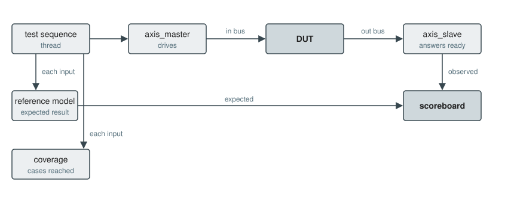

Overview
========

A testbench has four parts.

* The **device**: the Verilated model, with the shim that gives it plain ports.
* The **stimulus side**: a sequence, which is a thread, and the ``axis_master`` it calls to put beats on a stream.
* The **observation side**: an ``axis_slave`` that answers the device's output stream with ``ready`` and reports every
  transfer.
* The **checking side**: a ``scoreboard`` that compares results with what was expected, coverage, and the ``reporter``
  whose verdict is the exit code of the test.

         for the expected result, which goes to the scoreboard, and tells the coverage which case it was. The
         axis_slave on the output bus tells the scoreboard what was observed.
   :align: center
   :width: 100%

How a test is put together
--------------------------

A test is a ``sc_main`` that creates the objects of these parts and connects them. SystemC needs every signal, port and
process to exist before the simulation starts, so ``sc_main`` has this order:

1. ``sctb::init`` sets the time resolution, then the clock and the reset are created.
2. The device is created and its ``clock`` and ``reset`` ports are bound.
3. The ends of the streams are created, ``axis_source`` for a stream into the device and ``axis_sink`` for one out of
   it, and ``connect`` binds their buses to the ports of the device by name.
4. The trace is created with the clock and given the signals to write, the reset and the two streams.
5. The checking objects are created: the scoreboard, the coverpoints and the covergroup. The sink's results are routed
   to the scoreboard with one ``add_listener`` call.
6. The sequence object is created and started with ``spawn``, and ``run`` starts the simulation. When ``run`` returns,
   ``dut.final()`` closes the model.

The objects live on the stack of ``sc_main`` until ``run`` returns. Ownership is by containment:

* an ``axis_source`` owns an ``axis_bus`` and an ``axis_master``;
* an ``axis_sink`` owns an ``axis_bus`` and an ``axis_slave``, and the slave owns an ``axis_monitor``;
* the scoreboard, the coverpoints, the sequence and the model are objects of the test that refer to each other by
  reference;
* the reporter is a single object that every piece reports to.

Library and test
----------------

The library provides:

* the stream: the bus, the master, the slave and the monitor, and the source and sink that connect them to the device
* the scoreboard: the queue of expected results, the in order matching and the latency measurement
* coverage accounting, and the error for a bin that was never hit
* the end of test checks: drain, latency and throughput
* the reporter, the exit code and the progress line
* waveform tracing and the command line

The test provides:

* the shim that gives the device plain ports
* the model of the device: ``generate``, ``reference``, ``matches`` and ``classify``
* the coverage bins and the comparison that decides what a match is
* the sequence: what is sent, what is expected, and which checks run
* the wiring in ``sc_main`` and the number of vectors
* the signals to trace

The library works with beats, buses and times, and has no knowledge of what a device computes. The model is a plain
class with the functions the test needs, so it can be used and tried on its own.

Callbacks
---------

The library calls into test code through listeners. A monitor or a slave keeps a list of functions and calls them with
every transfer. A listener is an object and one of its member functions, ``add_listener(object, &class::function)``.
The converter tests have one: ``output.add_listener(scoreboard, &sctb::scoreboard::observe)``.

One transfer, from start to finish
----------------------------------

Take the test of a converter with one stream in and one stream out.

1. The **sequence**, a thread, builds a beat and calls ``master.write(beat)``. The master puts the beat on the input
   bus, raises ``valid`` and waits for the clock edge where ``ready`` is high.
2. The bus signals are bound to the ports of the Verilator model, so the device sees the beat at that edge. The
   call returns at that edge: the beat has been accepted.
3. Right after ``write`` returns, the sequence tells the scoreboard what must come out,
   ``scoreboard.expect(model.reference(beat))``, and tells the coverage which case the input was. The scoreboard
   remembers the time of this call.
4. Some cycles later the device puts a result on the output bus. The **slave** sees ``valid`` and ``ready`` on a clock
   edge and calls its listeners. One of them is the scoreboard.
5. The scoreboard takes the oldest expected result, compares it with the one received using the comparison the test
   gave it, and records the time between steps 3 and 5 as the latency of this result.

The sequence is the input side, the slave is the output side, and the scoreboard is where they meet: the sequence says
what should come out and the slave reports what did.

Where to read next
------------------

* :doc:`processes_and_time`: the three kinds of process, when signals are sampled and driven, how a test ends.
* :doc:`checking`: the scoreboard, the end of test checks, coverage and the reporter.
* :doc:`verilator_boundary`: the shim, connecting ports by name, widths.
* :doc:`waveforms`: the trace.
* :doc:`/api/index`: every class and function.
